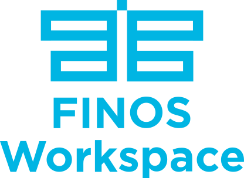

[](https://community.finos.org/docs/governance/lifecycle-stages/labs)

<h1 align="center">
  
</h1>

<div align="center">

**[Run it on your machine](docs/tutorials/build-from-source/run-the-stack-from-source.md)** · [Features](docs/features/index.md) · [Concepts](docs/concepts/index.md) · [Tutorials](docs/tutorials/index.md) · [Reference](docs/reference/index.md)

</div>

<p align="center">
  
</p>

Users connect their own data backends and arrange the data in dashboards of widgets. An AI agent answers questions about the dashboards, outside AI tools reach them through an MCP server, roles decide who may use what, and plugins add new kinds of widgets.

The code is in `frontend/`, `backend-api/`, `agent/` (the agent and its MCP server), `local/` (the development stack) and `docs/` with `website/` (the documentation).
## Developing locally

Both stacks below, the root `docker-compose.yml` and `local/`, are a developer's own machine: they run the API with `MODE=local`, and nothing in them needs editing for what follows.

**A data backend on your machine.** Under Connections, add it with the address you use in your browser, for example `http://localhost:9000`. The API makes every call to a backend, so for `localhost`, `127.0.0.1` and `[::1]` it calls your machine through `host.docker.internal`, which both compose files map for the API container. You need no CORS settings. The keys you type are stored encrypted in this stack's database and added by the API; the browser never holds them. On Linux the backend must listen on `0.0.0.0`, not only on `127.0.0.1`, because the container reaches your machine over the Docker network.

**An agent on your machine.** Under AI Library, AI Agents, Add Agent, give the address you use in your browser, for example `http://localhost:7777`. The API reads the agent's `agents.json` and makes every call to it, queries and tool round trips included, through `host.docker.internal` like a data backend, so the agent needs no CORS settings. The keys you type are stored encrypted in this stack's database and added by the API; the browser never holds them, and the list of agents names them without their values.

**An MCP server on your machine.** Under AI, MCP Servers, Add Server, give the address you use in your browser, for example `http://localhost:8787/mcp`. The API makes every call to the server, sign-in included, through `host.docker.internal` like a data backend, so the server needs no CORS settings. The headers you type are stored encrypted in this stack's database and added by the API; the browser never holds them. On Linux the server must listen on `0.0.0.0`.

**Widget plugins on your machine.** Put a built plugin in `widget-plugins/<plugin-id>/<version>/` next to `docker-compose.yml` (git ignores the folder, and `WORKSPACE_PLUGINS_DIR` points compose at another folder). It is mounted into the API as `/opt/widget-plugins`, where it can be written because a superuser may develop a version in place. Open Admin, Widgets, Deployment and choose Rescan. The steps after that are in [Build and try a widget plugin](docs/tutorials/plugins/build-a-plugin.md).

**Docker Compose is the standard way to develop locally**: the frontend, the API and the services run on your machine, and a backend on your machine is a connection to `localhost`, as above. **A deployed Workspace cannot reach a backend or an MCP server on your machine**, because its API makes the calls from the deployment's network. To test the deployed dev frontend against a local backend, expose the backend through a secured HTTPS tunnel and add the tunnel's public `https` address as a connection; the backend keeps checking its key, so the tunnel must not be left open to anyone. Use the tunnel only for that case. A connection kept by a superuser may be a private or plain `http` address on any stack, added on the Connections page like any other. For every other user, only a stack with `MODE=local` accepts one; elsewhere their connections must be public `https` addresses.

## Running the whole stack

`docker-compose.yml` builds and starts everything: MySQL, Valkey, the API, the background
worker, the web app, the Copilot's agent, and the MCP server with the tools it uses.

```bash
(cd backend-api/backend && python3 -m scripts.create_local_env --admin-email <your-email>)
# ...which also writes agent/.env: open it and set DEFAULT_MODEL and that provider's key (see Environment variables)
docker compose up --build        # on Apple silicon: PLATFORM=linux/arm64 docker compose up --build
```

`create_local_env` writes four files, none of which git tracks:

- `envs/.env` starts from `envs/.env.example`, points it at the compose services and fills in
  random keys: `JWT_SECRET`, `WORKSPACE_AUTH_TOKEN` (a JWT signed with it), `WORKSPACE_AES_KEY`
  (32 bytes, base64url: it encrypts the credentials stored in the database) and
  `LOCAL_STORAGE_SECRET_KEY`. It names the origins of the web app in `BACKEND_CORS_ORIGINS`.
- `scripts/cfgs/config.toml` names the organization (`--entity-name`) and the administrator that
  the first start creates. It holds no password.
- `user_create.json` starts empty. Compose mounts it into the containers and the first start fills it in.
- `agent/.env` holds the agent's model settings and its two secrets. It starts from `agent/.env.example`; the script sets
  `AGENT_METERING_TOKEN` (the token with which it reports usage, signed with `JWT_SECRET`) and `AGENT_SCOPE_SECRET`, and on
  a later run changes nothing else in it.

It refuses to overwrite the first two unless you pass `--force`; `--force` also gives the agent a new metering token.

The web app is on <http://localhost:3000>, the API on <http://localhost:8000> and the agent on <http://localhost:7777>. The MCP server and the metrics ports publish nothing: the web app reaches the tools through the API,
and Prometheus reaches the metrics from inside the deployment. The first start
creates the organization and the administrator listed in
`backend-api/backend/scripts/cfgs/config.toml`, without a password. Set it (typed twice, not shown):

```bash
docker compose run --rm init python -m scripts.init_users --new-password <your-email>
```

Then sign in with that email and password. Run the same command to set a new password; every
session of the account ends. No password is printed, logged or kept in a file.
`docker compose down -v` removes the databases too. To edit the code with hot reload instead, see `local/`.

## Environment variables

Only two things are yours to set. Everything else is generated by `create_local_env` or has a default.

1. **`--admin-email`** for `create_local_env`, which also generates every backend secret, the agent's two secrets and the URLs.
2. **`DEFAULT_MODEL` and the key of its provider** in `agent/.env`. The stack starts without them, but the agent
   answers that no model is configured.

The variables live in four places:

| Where | Read by | Who sets it |
|---|---|---|
| `backend-api/backend/envs/.env` | `init`, `api` and `worker` (`env_file` in compose) | `create_local_env`; edit it for anything beyond the defaults |
| `agent/.env` | `agent` and `agent-mcp` (`env_file` in compose; compose does not start without the file) | `create_local_env` for its two secrets; you for its model and keys |
| `environment:` of the `web` service | the web container, which writes `config.js` from them each time it starts | `docker-compose.yml` |
| your shell, or a `.env` next to `docker-compose.yml` | `${…}` substitution inside `docker-compose.yml` | you, optionally |

After editing a file, `docker compose up -d` recreates the containers that changed. `PLATFORM`, and `API_URL` for the admin
panel, are used when the images are built, so changing them needs `docker compose up -d --build`.

### Compose (shell or `.env` next to `docker-compose.yml`)

| Variable | Default | What it does |
|---|---|---|
| `PLATFORM` | `linux/amd64` | CPU architecture the api, worker and web images are built for. Use `linux/arm64` on Apple silicon. |
| `API_URL` | `http://localhost:8000` | The API's address as the browser sees it. It becomes `BACKEND_URL` of the web container. Set `SELFURL` in `envs/.env` to the same address. |
| `AI_API_URL` | `http://localhost:7777` | The agent's address as the browser sees it. The browser calls it directly. |
| `WEB_URL` | unset: every origin | The web app's address as the browser sees it. When set, the agent allows requests from this origin only (`AGENT_CORS_ORIGINS`); unset, it allows every origin. The browser calls the agent directly, so the origin is whatever address you opened the web app on — `localhost`, `127.0.0.1`, your machine's address on the network, a tunnel — and an origin it does not allow is a Copilot that fails with nothing in the interface to say why. A developer machine cannot know which address you will use, and the API allows every origin here too (`DISABLE_CORS=1`), so the default matches it. Set it for a deployment: the agent refuses to start with users and no origins at all. It is also the Origin of the agent's calls to the API (`WORKSPACE_ORIGIN`), `http://localhost:3000` when unset. |
| `AI_COPILOT_ENABLED` | `true` | Shows the Copilot panel. Must be `true` or `false`. |
| `WORKSPACE_PLUGINS_DIR` | `./widget-plugins` | The folder on your machine that is mounted into the API as `/opt/widget-plugins`, where widget plugins are placed (`local/compose.yaml`: `../widget-plugins`). |

### Backend (`backend-api/backend/envs/.env`)

`create_local_env` starts from `envs/.env.example` and sets these for the compose stack. The first five have no default in
the code, so the API does not start without them.

| Variable | Written by `create_local_env` | What it is |
|---|---|---|
| `MODE` | `production` | One of `production`, `local` or `test`. `local` is a developer's own machine: both compose files set it, whatever the file says. It lets any user's connection point at a private or plain `http` address, `localhost` among them (see Developing locally), and lets a superuser develop widget plugin versions in place ([Build and try a widget plugin](docs/tutorials/plugins/build-a-plugin.md)). |
| `FRONTENDURL` | `http://localhost:3000` | Address of the web app. |
| `APPURL` | `http://localhost:3000` | Address of the web app that the API uses for links back to it, such as login redirects. |
| `SELFURL` | `http://localhost:8000` | The API's own address, used to build links to files. |
| `WORKSPACE_AES_KEY` | random, 16 characters | Encrypts stored data. Never change it once the database has data. |
| `JWT_SECRET` | random | Signs the sign-in tokens. |
| `WORKSPACE_AUTH_TOKEN` | a JWT signed with `JWT_SECRET` | The deployment's service token: requests that carry it are exempt from rate limits. |
| `LOCAL_STORAGE_SECRET_KEY` | random | Signs the links to uploaded files. The code's own default is a fixed string, so always set it. |
| `STORAGE_PROVIDER` | `folder` | Where uploaded files go: `folder` (the `storage` volume), `aws`, `azure` or `gcp`. |
| `DB_HOST`, `DB_NAME`, `REDIS_HOST` | `mysql`, `workspace`, `valkey` | The compose services. The `api`, `init` and `worker` services also set `DB_HOST` and `REDIS_HOST` themselves, and compose's value wins. |

The rest of `envs/.env.example` stays as it is: `DATABASE_TYPE=mysql`, `DB_PORT=3306`, the `root`/`root` database login (the
`mysql` service in `docker-compose.yml` is created with the same password; change both or neither), the `REDIS_*` settings,
`WORKERS=1` and so on. Settings you may want to change:

- `DISABLE_CORS=1` lets every origin call the API. Outside a local machine set it to `0` and list the web app's address in
  `BACKEND_CORS_ORIGINS`.
- `DISABLE_REGISTRATION=1` stops the creation of new users; existing users still sign in.
- `STORAGE_PROVIDER=aws`, `azure` or `gcp` needs the matching block of the file (`S3_*`, `AZURE_*`, `GCP_STORAGE_BUCKET`).
- Sign-in with Microsoft or Okta is set in `envs/.env` only (`AZURE_CLIENT_ID`, `AZURE_TENANT_ID`, `AZURE_CLIENT_SECRET`, `OKTA_CLIENT_ID`, `OKTA_DOMAIN`, `OKTA_CLIENT_SECRET`): the API runs the sign-in on the server and the browser holds no token of the provider. `ADMIN_NOTIFY_*` sends admin notifications to a webhook; without a URL they are logged.
- `DEFAULT_MCP_SERVERS` is a JSON list of `{"id", "name", "url"}`: MCP servers that every user has, enabled, besides the ones
  they add (a user's own entry for the same URL wins, so they can still switch one off). Compose sets it to the agent's tools,
  `http://agent-mcp:8787/mcp`. The URL is the one the API calls, so it may be an address only the deployment can resolve: the
  API reaches a default server's host and port wherever they are. Other MCP servers it reaches only at public addresses (it
  refuses `localhost` and raw IP addresses) unless their host is in `ALLOWED_MCP_HOSTNAMES`, the user is a superuser, or the
  stack runs with `MODE=local`.

`.env.example` explains every setting in comments.

### Web (`environment:` of the `web` service)

`BACKEND_URL`, `AI_API_URL` and `AI_COPILOT_ENABLED` are set in the compose file (from `API_URL`, `AI_API_URL` and
`AI_COPILOT_ENABLED` above), and so are `ALLOW_HTML_JS_EXECUTION` and `UI_SHOW_COMPANION_MCP_MODE`, which this stack turns
on for development: scripts run in HTML widgets and Copilot artifacts, and the MCP Companion entry shows in the menu. A
deployment sets neither, so both keep their code default of `false`, unless its environment says otherwise. Every other
setting is one more `environment:` entry. A variable that is not set keeps its
default (in `frontend/src/lib/runtimeConfigSchema.ts`); a true/false variable must be exactly `true` or `false`, or the
container refuses to start.

| Group | Variables (default) |
|---|---|
| Sign-in | `AUTHENTICATION_ALLOW_EMAIL_LOGIN` (`true`); `AUTHENTICATION_IDENTITY_PROVIDERS` (comma-separated, none); `GOOGLE_OAUTH_CLIENT_ID` (empty); `AUTHENTICATION_SEND_USER_EMAIL_AS_HEADER` (`false`) |
| Copilot | `AI_COPILOT_DEFAULT_COPILOT`, `AI_COPILOT_DOCUMENTATION_LINKS`, `AI_COPILOT_WEB_SEARCH`, `AI_COPILOT_JINA_AI`, `AI_COPILOT_AI_ENHANCEMENTS`, `AI_SHOW_CUSTOM_COPILOT_KEY` (`true`); `AI_COPILOT_SEC_FILINGS`, `AI_COPILOT_SAVE_SKILL_FROM_CHAT` (`false`) |
| Interface | `UI_SHOW_MINIMIZE_WIDGET`, `UI_SHOW_EXTERNAL_DOCUMENTATION_LINKS`, `UI_SHOW_HELP_DOCUMENTATION`, `UI_SHOW_CHANGELOG`, `UI_SHOW_COPILOT_SWITCHER`, `UI_SHOW_REMOVE_FROM_ORG` (`true`); `UI_SHOW_COMPANION_MCP_MODE` (`false`); `UI_DEFAULT_THEME` (`dark`; `light` or `dark`) |
| Other | `ALLOW_HTML_JS_EXECUTION` (`false`: scripts in HTML widgets and Copilot artifacts; iframe widgets always run theirs, sandboxed); `DOCS_URL`, `SUPPORT_EMAIL` (empty: the links are hidden) |
| White label | `WL_NAME`, `WL_SHORT_NAME`, `WL_LOGIN_IMAGE`, `WL_LOGIN_IMAGE_DARK`, `WL_LEFT_SIDEBAR_LOGO`, `WL_LEFT_SIDEBAR_LOGO_DARK`, `WL_FAVICON`, `WL_DESCRIPTION`, `WL_KEYWORDS`, `WL_MAIN_COLOR`, `WL_FONT_FAMILY`, `WL_SHOW_FLOATING_THEME_PREVIEW` |

### The agent (`agent/.env`)

`create_local_env` creates `agent/.env` from `agent/.env.example`, which has every variable with comments. The agent is configured
only through the environment: no model, provider or key is written in its code. Compose also sets `WORKSPACE_API_URL`
(`http://api:8000`), `WORKSPACE_ORIGIN` (from `WEB_URL`, else `http://localhost:3000`), `WORKSPACE_PUBLIC_URL` (from `API_URL`) and
`AGENT_CORS_ORIGINS` (from `WEB_URL`) for it. `WORKSPACE_ORIGIN` is the Origin of every call it and its MCP server make to the API, which refuses
an origin it does not allow: with `DISABLE_CORS=0`, list it in `BACKEND_CORS_ORIGINS`.

| Variable | Set it | What it is |
|---|---|---|
| `DEFAULT_MODEL` | always; no default | The model, written `<provider>:<model>` where `<model>` is whatever that provider calls it. Every call the agent makes uses it unless the user picks another model in the FINOS Workspace settings. |
| `NVIDIA_API_KEY`, `OPENAI_API_KEY`, `OPENROUTER_API_KEY`, `GROQ_API_KEY` | the one of the provider `DEFAULT_MODEL` names | Registers the provider with the prefix `nvidia:`, `openai:`, `openrouter:` or `groq:`. A provider without a key is left out, and a model that names it fails with "No provider for model". |
| `OLLAMA_BASE_URL` | for `ollama:` models | Default `http://localhost:11434/api`. Inside the container `localhost` is the container itself, so for Ollama on your machine use `http://host.docker.internal:11434/api`. |
| `AGENT_MODELS` | optional | More models users may pick, comma-separated, written the same way. The agent offers `DEFAULT_MODEL` and these, and refuses any other: the keys are the operator's, so a user cannot spend them on a model the operator did not choose. The role grants (Admin → Roles, a role's Copilot access) choose among them. |
| `AGENT_TRANSCRIBE_MODEL` | for dictation | The model that turns what a user says into the text of a question, written `<provider>:<model>` with that provider's key: `groq` (e.g. `groq:whisper-large-v3-turbo`), `openai` (e.g. `openai:gpt-4o-mini-transcribe`) or `nvidia`, NVIDIA's hosted speech models named as on build.nvidia.com (e.g. `nvidia:openai/whisper-large-v3`). The web app records in any browser and the agent transcribes; unset, the chat has no microphone. |
| `AGENT_METERING_TOKEN`, `AGENT_SCOPE_SECRET` | `create_local_env` writes them | The token with which the agent reports usage to the API (what `python -m scripts.create_metering_token` prints), and a secret of at least 16 characters that signs the chat scopes the tools receive (see below). The agent does not start without them. |
| `AGENT_AUTH` | default `workspace` | `workspace`: every caller signs in with the API. `none`: no users and nothing counted, for a development machine only; the agent then logs a warning. |
| `AGENT_AUTH_CACHE_SECONDS`, `AGENT_MAX_CONCURRENT_QUERIES`, `AGENT_MAX_BODY_MB` | optional | How long a signed-in user is remembered (30), how many queries one user may have running at once (4) and the largest request in MB (64). |

Optional: `PORT` (7777; compose publishes that port, so leave it), `LIVE_DEBUG_TRACES` (`1` prints a trace of each turn, `2`
adds the full model input and output; local use only) and `LLM_STREAM_TIMEOUT_MS` (how long one model call may run, in milliseconds;
default 240000). Logs and metrics have their own variables, below.

### The MCP server (`agent/.env`, read by `agent-mcp`)

The tools the agent uses live in `agent/mcp-server/` and run in compose as `agent-mcp`. Every user has the server by default. `web_search`
(DuckDuckGo, no key), `fetch_webpage` and `inspect_webpage` need nothing; the others are there when what they need is set, and the server logs at
start which are not and why.

| Variable | What it enables |
|---|---|
| `AGENT_EMBED_MODEL` | `query_documents` and `list_documents`: search of the documents a user attached, with the page of each hit. Written `<provider>:<model>` like `DEFAULT_MODEL`, with that provider's key (`openai`, `openrouter`, `nvidia` and `ollama` embed). |
| `COMPANION_TOOLS_ENABLED` | The tools that drive a FINOS Workspace browser tab (`true`; off by default). |

`mermaid_diagram` needs Chromium, which the image does not contain.

## Users, roles and limits

The FINOS Workspace owns the users, their roles and their usage limits, and the agent asks the API instead of keeping users of its own.
Every request to the agent (apart from `/agents.json`, `/status` and `/ready`) carries the user's session token, and the API says whose
it is. For each question the agent then asks the API, with the token it trusts only the operator and the agent to hold:

- **the model and the tools.** What the user's roles grant (Admin → Roles, a role's Copilot access) is what the agent allows. A model the
  roles do not grant is refused in the chat; a tool they do not grant is left out. Without a grant there is no access.
- **the daily limit.** The first request of a turn is counted against the user's daily limit of questions, and the tokens it
  used are added to their daily tokens; when a limit is reached the chat says so in the API's words. Setting the limits is the
  admin's job, on the user's roles.

The tools that keep state for a chat (the document store, the fetched pages) file it under the user and the chat, and accept only
a chat scope that the agent has signed with `AGENT_SCOPE_SECRET`: a user's browser makes the calls to the tools, so without the
signature it could name another user's chat. The MCP server publishes no port, and the API's MCP proxy checks the user's roles
on every tool call. Both services fetch only public addresses on behalf of a client (the FINOS Workspace's own file links are the one
exception, fetched from `WORKSPACE_API_URL`), so a user cannot make them read the deployment's internal services.

**What the model is given.** The FINOS Workspace sends the whole chat with every request, and the agent gives the model only the current turn, plus a note that earlier messages exist and a tool, `recall_conversation`, with which it reads them when a question needs them. So a question costs about the same at the 300th exchange as at the 5th, instead of growing with the chat, and a long chat does not end in a request the model refuses. The tokens a question uses count against the user's daily limit.

**The FINOS Workspace's own tools.** The agent reads and changes the FINOS Workspace with the FINOS Workspace's own tools: reading a widget, adding,
updating or moving one, editing the tabs, navigating, and the rest of what the FINOS Workspace MCP server offers external hosts. The
FINOS Workspace describes them to the agent with its other tools (the same names, descriptions and schemas as an external host gets, from
the same server: `GET /app/workspace-tools`), and when the agent calls one, the user's own tab runs it, as the user who is signed
in: nothing is handed to the agent but the call's result, and no token or bridge session is involved. The API checks every call
(`POST /app/workspace-tools/prepare`) against what the user's roles grant, as it does for any MCP tool, with the address of the
tools' endpoint as the server's. The agent always has all of them, whatever page the user is on. Each widget in a request advertises its current
parameters, and these are what the widget is showing: a parameter that belongs to one of the dashboard's parameter groups is
advertised with the group's value, which is what the widget shows, not with the value it stored. A widget that embeds a page of its
own backend (`iframe`) is advertised as such, and the agent reads its state from those parameters and changes it with the FINOS Workspace's `update_widget`, which
hands the value to the page through the iframe protocol and confirms it. External hosts do not use any of this: they
connect to `/mcp` with a personal access token and a bridge session that the user opens.

The tools are given in two ways. The tools that the FINOS Workspace supplies are always given in full, each with its description and its parameters, because that is what says how a tool is used and the model reads it before it acts: those of the servers the user has connected, and the FINOS Workspace's own. The agent's own tools are given the few every question can need, and a short catalog of the rest by what they are for (query tables, search the web, read a document, run Python, …). The model loads the group it needs with `load_tools`, and the instructions for those tools are in its prompt only while they are loaded; the agent loads the SQL tools itself once there are tables to query, and the document tools when there is a PDF to read.

**PDFs and other documents.** A PDF or DOCX, whether it is attached to the chat or is a PDF widget on the dashboard, is never put in front of the model and never handed to it as a file (providers refuse a request that carries one). When the model loads the file widget, the FINOS Workspace gives the agent a signed link to it; the agent passes the link to `agent-mcp`, which fetches the file from where it is kept, reads it page by page, and keeps it for the chat. The model reads it with `query_documents` (its question and the file's id): each passage it gets back says which page it is on. The answer's citations are the file at the pages the answer names, so "Go to reference" opens the file at that page. A PDF that is only pictures has no text to read, and the answer says so. The search needs `AGENT_EMBED_MODEL` (and its provider's key); without it the answer says that the file cannot be read.

The agent holds its state (the rows of a chat's widgets, its documents) in memory and files each chat under its user. It does not
survive a restart and is not shared between replicas, so run one replica, or send a chat's requests to the same one: a request
that reaches another replica in the middle of a turn is counted as a new turn.

## Running at scale

Everything a web app used to ask of a data backend directly now goes through the API, so size and place the API for that.

- **Replicas and workers.** Each API process keeps its own caps (128 open backend requests per user, 2,000 per process, 1,000 sockets per process) and its own file descriptors; add processes for more. The database pool is sized from `WORKERS` and shared with every other route: the API gives a connection back before it calls a backend, so streams do not use pool connections.
- **Ingress and load balancer.** Allow requests and idle connections of at least 125 seconds on the API's routes (the API ends a request that has had no answer for 50 seconds and a stream that has been quiet for 120), and keep WebSocket upgrades. Serve the API over HTTP/2: browsers open six HTTP/1.1 connections to an origin, and long streams or sockets from framed pages would use them up. Do not buffer responses. Mask the `ws_frame_` part of the path in the access log.
- **Worker recycling.** `run.py` restarts a worker only after about a million requests, with 120 seconds for its open requests to finish, so that a restart does not cut every stream; lower `max_requests` only if you see memory grow.
- **Database.** A proxied request reads the session and the connection, two queries, and gives the connection back before it calls the backend. Who may read a connection (the user's role grants, the owner being a superuser) is worked out once per user and connection and kept by each API process for 30 seconds, so a role change or a revoked grant reaches an open page within that time; the connection's own address and credentials are read on every request, so an edit applies at once.
- **Valkey.** The rate limiter and the sessions use it. The per-user rates (1,200 proxied calls, 6,000 framed-page requests, 120 frame grants and 120 sockets a minute) are counted there and hold across replicas; the caps on open requests and sockets are per process. If Valkey does not answer for a second, the API stops counting proxied requests for 30 seconds instead of failing them; the per-process caps still hold.
- **MCP servers.** The calls the agent makes to a user's MCP servers, and the streams the web app keeps open to them, go through the API's `/app/mcp-proxy` with the same care as the data connections: a user's open requests count once whether they go to a data connection or an MCP server, no database connection is held while a server answers, a server that fails five times in a row is refused for ten seconds, a call whose browser has gone away is cancelled, a request body is read only up to 10 MiB, and a user may make 1,200 calls a minute. A stream to an MCP server has no time limit of its own; it ends when the server, the browser or a deployment ends it. The connection pool is as large as the process admits.
- **Agents.** The questions a user puts to an agent they added, the answers it streams back, its tool round trips, its feedback and its uploads go through the API's `/app/custom-copilot/{id}/relay`, with the same care as the data connections: places are shared with them, the same breaker and the same abandon-and-cancel apply (a question the browser stopped waiting for is cancelled at the agent, so it stops paying for the model), no database connection is held while the agent works, and a user may make 1,200 calls a minute. An agent has 120 seconds to start answering and 10 minutes between two bytes, longer than a data connection, because a model can think for a while. A body is read in memory before it is sent, up to 64 MiB, and a process holds at most 256 MiB of such bodies at the same moment; past that it answers `503` with `Retry-After`. The built-in agent is not relayed: the web app calls it with its own short-lived token.
- **Streams and sockets.** A streamed answer or a WebSocket is held by the process that accepted it until it ends, and ends when that process does, so a rolling deployment closes the ones of the replicas it replaces and the page has to open them again.
- **Backends that are slow or down.** Waiting for a backend takes no thread and no database connection: the request is an asyncio task that holds a socket and one place in the process's counts. A process lets at most 512 requests wait at the same moment for the first byte of one backend and answers the others at once with a 503 and `Retry-After`, so one slow backend cannot take the places the others need; a request that already has its headers is no longer waiting, so streams are not counted. After five failures in a row to reach a backend (no answer within 50 seconds, or no connection), the process refuses requests to it for ten seconds, then lets one request through to try it, and an answer of any status, an error included, ends the refusal. A request whose browser has gone away is cancelled at once and gives its place back.

## Logs, metrics and health

**Logs** go to stdout, one JSON object per line (`LOG_FORMAT=pretty` for people), at `LOG_LEVEL` (`info` in production, `debug`
otherwise). Every record carries the request id (the `X-Trace-Id` header); a record made while a question is answered also carries the user and the chat. Before it is
written, every record is cleaned of session tokens, API keys, signed file URLs, file bytes, the messages of a conversation and
email addresses, so a provider's error shows what went wrong without the conversation. The token in the address of an iframe page that needs the connection's credentials (`/app/data-connectors/frame/ws_frame_…`) is masked in the API's logs; mask it in the access log of your load balancer or ingress too. One `audit` record is written for each
question (outcome, tokens, duration), each refusal (not signed in, model, role, limit) and each tool call.

**Metrics** are Prometheus text on a port of their own that compose does not publish: `agent:9464/metrics` and
`agent-mcp:9465/metrics` inside the deployment (`AGENT_METRICS_PORT` and `MCP_METRICS_PORT`; `0` turns them off). They count
requests by route and status, questions by outcome (`agent_queries_total`), model tokens, model calls and errors by provider, calls to the
API, and tool calls by tool, with their durations. No metric is labelled by user or chat.

**Traces** are OpenTelemetry: set `OTEL_EXPORTER_OTLP_ENDPOINT` to export them (details in [agent/README.md](agent/README.md)).

**Health:** `/status` says the process is up (the container's health check); `/ready` also asks the API and answers 503 while
it does not answer.

## Notes

- The workflows in the root `.github/workflows/` are the ones GitHub Actions runs: the checks on pull requests
  (`frontend-checks.yml`, `backend-checks.yml`, `pr-description.yml`), the end-to-end tests (`e2e.yml`) and the build
  check (`pr-build-check.yml`). The app's settings are defaults in its code.

## Advisory Committee

An Advisory Committee has been formed to ensure the roadmap reflects the needs of buy-side and sell-side institutions. The committee brings together maintainers, global banks, and consultancy partners to guide architectural decisions and open-standards integration. The current members are listed below:

- Alexandru Dumitru, Engineering Lead, Global UI Platform at Citi
- Kris West, FDC3 Lead Maintainer
- Chris Watson, Lead Sail Maintainer and Head of Interoperability at AlphaFMC
- Jorge Vasquez, Global Product Manager, Bank of America

## Get involved

- Subscribe to the FINOS Workspace mailing list by sending an email to  `workspace-dev+subscribe@lists.finos.org`
- Intrested in joining the advisory committe? Email [workspace-dev@lists.finos.org](mailto:workspace-dev@lists.finos.org) about joining.

## License

Copyright 2026 FINOS

Distributed under the [Apache License, Version 2.0](http://www.apache.org/licenses/LICENSE-2.0).

SPDX-License-Identifier: [Apache-2.0](https://spdx.org/licenses/Apache-2.0)

Individual components may carry additional notices in their own directories.
