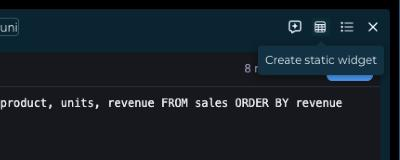
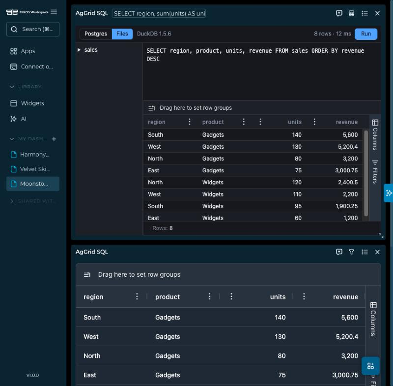
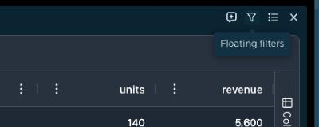
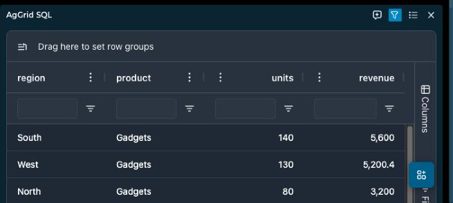
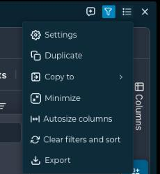

# AgGrid for FINOS Workspace

A FINOS Workspace widget plugin with four widget types, all drawn by [ag-grid](https://www.ag-grid.com/):

| Widget | Type | A backend's widget gives it | Rows come from |
|---|---|---|---|
| AgGrid table | `aggrid-table` | An endpoint that returns the grid as JSON. | The endpoint, again whenever it is refreshed: rows with an `id` are applied as a difference. |
| AgGrid live grid | `aggrid-livegrid` | An endpoint with the columns and a first snapshot, and `data.streamEndpoint`, a WebSocket. | The socket, which FINOS Workspace opens: snapshots, upserts and removals by row id. |
| AgGrid server-side table | `aggrid-ssrm` | `data.aggrid-ssrm.table`, a Postgres table. | The plugin's own backend: every page, sort, filter, row group, aggregate and pivot is a query. |
| AgGrid SQL | `aggrid-sql`, and a widget of its own in Add widget | Nothing. | The plugin's own backend, for the query typed in the card. |

The package bundles two libraries with different licences: `ag-grid-community` (MIT) draws the
grid, and `ag-grid-enterprise` (commercial) adds the side bar, row groups, pivoting, range
selection, the status bar, server-side rows and integrated charts. Without a licence key the
Enterprise features run in AgGrid's trial mode, with a watermark; see [License key](#license-key-ag-grid-enterprise).
It is an example in the repository's `docs/examples/`, a package of its own that nothing in FINOS
Workspace imports, built and deployed the way any plugin is
([Plugin package and manifest](../../reference/plugins/package-and-manifest.mdx)).

## Every grid

Every grid, whatever a backend sends in `gridOptions`, has:

- the **Row Groups** drop zone above the columns, and the **Columns** and **Filters** panels in a side bar. In the
  Columns panel, *Pivot Mode* turns the grid into a pivot table and shows the **Column Labels** drop zone beside
  Row Groups; AgGrid shows that zone only in Pivot Mode. Every column can be grouped, pivoted and aggregated,
  except that a text column cannot be summed.
- range selection with a status bar, and a chart of the selected range from the context menu (Chart Range:
  column, bar, pie, line, scatter, area, statistical and combination charts) in a dark or light chart theme that
  follows the site;
- the site's `theme=dark` or `theme=light`, in `ag-theme-quartz` and `ag-theme-quartz-dark`, in a compact
  density: 26 px rows, a 30 px header, formatted and right-aligned numbers, columns that share the card's width, and
  pagination only above 100 rows, with as many rows per page as fit.

A column definition can still say `enableRowGroup: false`, `enablePivot: false` or `enableValue: false` for one column.

The widgets write what the user does (selection, filter, sort, column moves, edits) to the `state` trait with
`model.save_changes()`, and give the Copilot the row count, the columns, the selection, the filter, sort and
grouping, and, for client-side grids, per-column statistics read from the grid.

## AgGrid table

The backend declares a widget of type `aggrid-table` and returns JSON:

```json
{
  "sales": {
    "name": "Sales by region",
    "type": "aggrid-table",
    "endpoint": "/sales"
  }
}
```

The endpoint returns JSON at the `dataKey` path (a dot-notation path into the response, set in
`widgets.json`). The plugin accepts five shapes.

An ag-grid-ready object, with explicit column definitions and grid options:

```json
{
  "columnDefs": [
    { "field": "region", "headerName": "Region", "width": 150 },
    { "field": "sales", "headerName": "Sales", "width": 100 }
  ],
  "rowData": [
    { "region": "EMEA", "sales": 100 },
    { "region": "APAC", "sales": 105 }
  ],
  "gridOptions": { "rowSelection": "multiple", "pagination": true, "paginationPageSize": 20 }
}
```

A list of records (pandas `to_dict('records')`):

```json
[{ "region": "EMEA", "sales": 100, "date": "2024-01-10" }, { "region": "APAC", "sales": 105, "date": "2024-01-12" }]
```

A dict of columns (pandas `to_dict('list')`):

```json
{ "region": ["EMEA", "APAC"], "sales": [100, 105], "date": ["2024-01-10", "2024-01-12"] }
```

The pandas split format:

```json
{ "columns": ["region", "sales"], "index": [0, 1], "data": [["EMEA", 100], ["APAC", 105]] }
```

And column definitions that group rows, here the `region` column as the row group:

```json
{
  "columnDefs": [{ "field": "region", "rowGroup": true, "hide": true }, { "field": "sales" }],
  "rowData": [{ "region": "EMEA", "sales": 100 }, { "region": "APAC", "sales": 105 }]
}
```

Without column definitions the plugin infers them from the data:

| Inferred type | Condition | Treatment |
|---|---|---|
| `numeric` | Mostly numbers | `agNumberColumnFilter`, right-aligned, grouped digits |
| `date` | ISO 8601 date strings | `agDateColumnFilter` |
| `boolean` | Mostly booleans | "Yes" or "No" |
| `string` | Everything else | Text filter |

Any `ColDef` and `GridOptions` property that JSON can carry is accepted. JSON cannot carry functions, so a column
names AgGrid's built-in `cellEditor` and `cellRenderer`, and the frame's policy blocks `eval`, so expression strings
for `valueGetter` or `valueFormatter` do not run.

- **Editing.** A column with `editable: true` accepts edits. An edit stays in the card: it is recorded as a
  `cellValueChanged` event in the `state` trait and is not sent to the backend.
- **Streaming.** When the endpoint answers again (`refetchInterval` in `widgets.json`), rows that all carry an `id`
  are diffed and applied with `api.applyTransaction()` as adds, updates and removes. Rows without an `id` replace
  the grid's data.
- **Export.** The export dialog offers *Rows (CSV)*, the text of `api.getDataAsCsv()`.

## AgGrid live grid

The backend declares a widget of type `aggrid-livegrid` with a `data.streamEndpoint`, a WebSocket of its own:

```json
{
  "prices": {
    "name": "Live prices",
    "type": "aggrid-livegrid",
    "endpoint": "/prices/columns",
    "data": { "streamEndpoint": "/prices/ws" }
  }
}
```

The socket is FINOS Workspace's, not the plugin's: the plugin has the permission `core:data:stream`, the host opens the
address through the FINOS Workspace API as it builds the widget's request (the params as query values, `ws` or `wss` for
`http` or `https`), the API adds the backend connection's credentials, and the host hands the JSON messages to the frame as events
([the plugin permissions](../../reference/plugins/commands-and-permissions.mdx)). The frame needs no network, no policy override and no secret.

The endpoint returns the grid before the first message, `{ columnDefs, rowData, gridOptions }`, with an `id` in every row.
The socket then sends JSON messages:

| Message | Does |
|---|---|
| `{ "op": "snapshot", "rows": [...] }` | Replaces all rows. |
| `{ "op": "upsert", "rows": [...] }` | Updates the rows whose `id` the grid has and adds the others. |
| `{ "op": "remove", "ids": [...] }` | Removes the rows. |

The host gathers messages for 100 ms, and the plugin applies them as one transaction every 150 ms. A cell whose value changed
flashes (`enableCellChangeFlash`, 0.6 s, fading over 1.8 s), and a column can show the direction of the change with the
`agAnimateShowChangeCellRenderer`, as the examples backend's *Price* column does. A strip above the grid says what the host
reports: *Connecting*, *Live*, *Disconnected, retrying in n s* (1 s, then doubling up to 15 s) or *Closed*. Refreshing the card
opens the socket again.

## AgGrid server-side table

The backend declares a widget of type `aggrid-ssrm` with the table in its definition:

```json
{
  "trades": {
    "name": "Trades",
    "type": "aggrid-ssrm",
    "endpoint": "/trades",
    "data": { "aggrid-ssrm": { "table": "demo.trades", "pageSize": 100 } }
  }
}
```

The widget reads nothing from the endpoint. It calls two routes of the plugin's backend, which reads the Postgres
whose URL is the plugin's `postgres_url` secret:

| Route | Answers |
|---|---|
| `ssrm_columns` | The table's columns with their types and kinds (`number`, `date`, `boolean`, `text`), from `information_schema`. The widget turns them into column definitions with the right filter for each. |
| `ssrm_rows` | One block of AgGrid's server-side request, JSON-encoded: `startRow`, `endRow`, `sortModel`, `filterModel`, `rowGroupCols`, `valueCols`, `pivotCols`, `pivotMode`, `groupKeys`. |

The backend turns the request into one query, with the values as parameters and the names quoted after they were
checked against the table's columns:

- **Paging and sorting**: `LIMIT` and `OFFSET`, `ORDER BY` the sort model and then `ctid`, so pages do not overlap. The
  answer carries the exact row count, which the pager shows.
- **Filters**: text (`equals`, `notEqual`, `contains`, `notContains`, `startsWith`, `endsWith`, `blank`, `notBlank`, case-insensitive),
  number and date (`equals`, `notEqual`, `lessThan`, `lessThanOrEqual`, `greaterThan`, `greaterThanOrEqual`, `inRange`, `blank`,
  `notBlank`), set filters, and two conditions joined by `AND` or `OR`.
- **Row groups**: one `GROUP BY` for the level being opened, the parent group keys as `WHERE`, the aggregates `sum`, `avg`, `min`,
  `max` and `count` of the value columns, and the number of groups as the row count.
- **Pivot**: in Pivot Mode with value columns, the distinct values of the pivot columns (at most 100) become columns, each
  `aggregate(value) FILTER (WHERE pivot = value)`, named `<pivot value>|<value column>` and sent as `pivotResultFields`.

A request that makes no sense (an unknown column, a sum of text, a pivot of more than 100 values, more than 1,000 rows) is
answered with a message the card shows. The table is a base table, not a view, and the Postgres role the secret names
should only be able to read: the connection is read-only and each query stops after 15 seconds. Numerics of a table are
sent as JSON numbers, so a `numeric` with more than 15 digits loses its tail.

## AgGrid SQL

The editor, its table list, the Postgres and Files sources and the DuckDB completion are the SQL explorer's, from the
same files ([SQL explorer](../sql-explorer/README.md)): a textarea in which DuckDB-WASM, running in a worker inside the frame,
suggests keywords, functions, tables and columns as you type (Ctrl+Space anywhere). The result is drawn in the
grid of this plugin, with every panel above. The plugin's backend serves the explorer's four routes
(`postgres_schema`, `postgres_query`, `files_schema`, `files_query`) from the explorer's `backend/` files, and the widget
writes the `sql` parameter on a Files run, so a dashboard group can feed it to a chart. The frame's policy gains
`script-src 'wasm-unsafe-eval'` and `connect-src blob:` for DuckDB, as the explorer's does.

The card's **Create static widget** button freezes the current result into an AgGrid table widget of its own, named
after the SQL widget with "(static)" added, with no parameters and no query: the first 60 columns and the first 1,000 rows, as the table's artifact holds them, and fewer rows
when they would pass 380,000 bytes, which keeps the copy under the host's limit. The button is the
widget's `freeze` action (`core:ui:button`), and the copy is made with the command `core:dashboard:add-widget`, which the
host takes only right after the click. Rename the copy and change its description in its **Settings**; it keeps a record of
the SQL widget it came from and when, which the AI agent sees, and its title tooltip shows when it was made.





## Card actions

The AgGrid table has a **Floating filters** button in its header, which switches the widget's `floatingFilters` setting
and shows a filter box under each column header while it is on, and two items in the card's options menu: **Autosize
columns** and **Clear filters and sort**. They are the widget's `actions` (`core:ui:button`, `core:ui:menu`); the
autosize item draws the package's own `assets/autosize.svg`, which the host sanitizes before it draws it. A static copy
made by the SQL widget is an AgGrid table, so it has the same button and menu items.

| Floating filters, hovered and on | The options menu |
|---|---|
|   |  |

## For the AI agent

Two of the four widgets declare an `artifact` (`src/plugin.json`), a component the AI agent can show
under its answer, and the user can add the card to a dashboard as a widget that keeps its data. The
card follows the site's light or dark mode.

- **`table`** takes an ag-grid-ready object: `rowData` (up to 1,000 rows of strings, numbers,
  booleans and nulls) and, optionally, `columnDefs` (a `field`, a `headerName`, a `type` of
  `numericColumn` or `rightAligned`, and a `width`). The agent can fill `rowData` from a table it has
  loaded instead of copying the rows.
- **`sql`** takes a query: `source` (`postgres` or `files`) and `sql` (one read-only SELECT, up to
  8,000 characters). The agent writes the query for a question about the deployment's data and the
  card runs it from the user's own session through the plugin's backend, as the widget does. The user
  can edit and rerun it, and the dashboard widget made from the card keeps the query.

The live grid and the server-side table need a backend that streams or serves a table, so the agent
adds them to a dashboard for the user and does not show them in the chat.

Two skills, in `src/skills/`, tell the agent how to use them. `ag-grid-tables` describes the four
widgets and when each fits, and the data of the table component. `ag-grid-sql` gives the exact steps for a question about the
deployment's data (load the `components` tool group, then show `ag-grid/sql` with a query), the two
sources and their dialects, what a query may be, and the tables of the example deployment.

## The package

| Path | |
|---|---|
| `src/plugin.json` | The manifest: four widgets, six routes, the `postgres_url` secret, the policy DuckDB needs, `identity: "pseudonymous"`, the organization's licence key setting. |
| `src/entry.js` | Hands each widget its module by the `widgetId` of its `meta` trait. |
| `src/grid.js` | What every grid shares: shapes, column inference, options, theme, the state it writes, CSV and Copilot context. |
| `src/table.js`, `src/livegrid.js`, `src/ssrm.js`, `src/sql.js` | The four widgets. |
| `backend/grid_server.py`, `backend/ssrm.py` | The plugin's backend: its routes, and the server-side query builder. |
| `../sql-explorer/src/widget.js`, `../sql-explorer/backend/` | The editor and the SQL engines this package builds in. |

The versions of everything are exact: AgGrid 32.3.9 (Community and Enterprise), esbuild, jsdom.

## License key (AgGrid Enterprise)

`ag-grid-community` needs no licence key. `ag-grid-enterprise` is commercial software: without a key it unlocks every
feature for trial with a watermark and a console notice, and a licence from
[AgGrid](https://www.ag-grid.com/license-pricing/) removes both. The plugin reads the key from two settings, in this order:

1. **Per-instance widget setting**: `licenseKey` in the widget's `settings`, for one card.
2. **Organization admin setting**: `licenseKey` under Admin, Widgets, AgGrid, Settings, for every card of the organization.

The plugin passes the key to `LicenseManager.setLicenseKey()`. Never put a key in the repository. `licenses/` in the built
package holds the licence files of both packages and of everything else bundled.

## Build

The package builds in the SQL explorer's tree as well as its own, so install both:

```bash
(cd ../sql-explorer && npm ci --ignore-scripts)
```

```bash
npm ci --ignore-scripts
```

```bash
npm run build
```

writes `dist/ag-grid/<version>/`: the bundled `entry.js`, `entry.css` (the editor's styles, this package's and AgGrid's
theme), DuckDB-WASM's files from the SQL explorer's build (`assets/`), `backend/`, `licenses/` and `plugin.json` with the
checksum. A version is about 40 MB, most of it DuckDB's binary.

## Test

```bash
python3 -m venv .venv
```

```bash
.venv/bin/pip install -r ../backend/requirements.txt pytest==9.1.1 httpx2==2.13.1
```

```bash
npm test
```

runs the widgets' tests in Node (the helpers, and each widget in jsdom with a real grid: rendering, CSV text, the Copilot
context, streaming transactions, a fake WebSocket for the live grid and a stub backend for the server-side table) and the
backend's in pytest. The server-side query tests need a database they may change: set `SQL_EXPLORER_TEST_POSTGRES` to an
administrator's URL, or `SQL_EXPLORER_TEST_POSTGRES_FILE` to a file holding it, for example of a throwaway container.
They create a schema and a read-only role of their own and drop them.

## Deploy

1. Copy `dist/ag-grid/<version>/` into the plugins directory (`WIDGET_PLUGINS_DIR`), as `ag-grid/<version>/`.
2. Check it with the server's validator, from `backend-api/backend`:
   `python -m scripts.plugin_check <plugins dir>/ag-grid/<version> --digest`.
3. Where versions must be pinned, add the printed digest to `WIDGET_PLUGINS_PINS` as `"ag-grid@<version>": "<digest>"`.
4. Run the plugin's backend (`backend/grid_server.py`, as [run a plugin backend](../../tutorials/plugins/run-a-plugin-backend.md)
   describes) and list it in `WIDGET_PLUGIN_BACKENDS`. Set the `postgres_url` secret, and add the Postgres's
   `tcp://<host>:<port>` to the server network.
5. Admin, Widgets, Deployment: Rescan, review, approve, and enable the plugin. Grant it to the roles that may use it.
6. Add widgets of the four types from a backend whose `widgets.json` declares them, or *AgGrid SQL* from Add widget.

Every change is a new version: raise `version` in `package.json` and build again. FINOS Workspace blocks an approved
version whose files change.

## Try it

The [examples backend](../backend/README.md) declares a widget of each type: the table in each data shape and one that
streams, a live grid on a socket it serves, a server-side table over 200,000 trades in its Postgres, and an SQL grid.
The *Sales by region* chart of the Plotly plugin shows its rows in the table widget.
